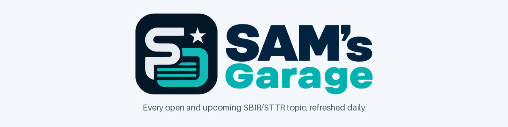
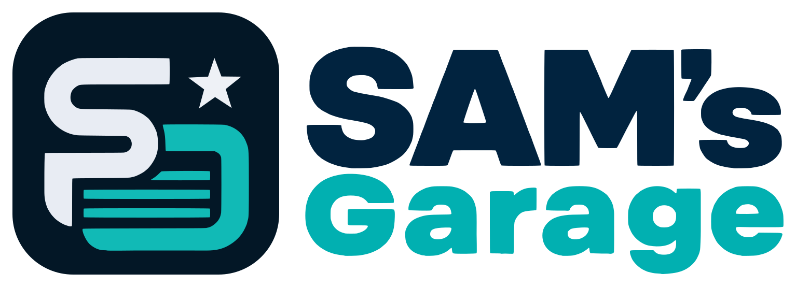

# 🛠️ [SAM's Garage (Sg)](https://lcintron.github.io/sams-garage/)

[](https://lcintron.github.io/sams-garage/)
[](https://github.com/lcintron/sams-garage/releases/latest)
[](https://github.com/lcintron/sams-garage/releases/latest)



Every open and upcoming U.S. federal SBIR/STTR topic and solicitation in one fast, searchable list: DoD (Army, Navy,
Air Force, DARPA, SOCOM, …), HHS/NIH, NSF, DOE, NASA, USDA, DHS, DOT, EPA, ED, DOC and more, gathered daily from
[SBIR.gov](https://www.sbir.gov/topics), the [DoD SBIR/STTR portal (DSIP)](https://www.dodsbirsttr.mil/topics-app/) and
[Grants.gov](https://www.grants.gov/). It runs in the browser (installable, works offline) or as a desktop app
([installers](https://github.com/lcintron/sams-garage/releases/latest) for Windows, macOS and Linux). All searching
happens on your device: no servers, accounts or tracking. The site is at <https://lcintron.github.io/sams-garage/>
for now; it will move to sg.luiscintron.com once that custom domain is configured (steps under "One-time setup" in
[How the data stays fresh](#how-the-data-stays-fresh)).

## Features

- **Instant list.** The app renders from a compact catalog, then builds a full-text index ([MiniSearch](https://lucaong.github.io/minisearch/)) in the background. Search covers titles, descriptions, keywords and topic numbers, with prefix and typo tolerance.
- **Filters** for status (open, pre-release, forecasted, closed), agency and sub-agency (with counts), program (SBIR/STTR), phase (I, II, direct to II), "closing within 7/14/30/60 days" and "opens on or after". The URL holds every filter, so you can bookmark or share any view.
- **Keyword profiles.** **#UAS**, **#Counter-UAS** and **#Acoustic** are built in, and you can add your own. They flag matching topics, show which terms matched, and rank by relevance.
- **New since your last visit.** Topics first seen after your previous visit get a NEW badge and a filter chip.
- **Watchlist.** Star topics to keep them in one place on this device.
- **Daily notifications.** One report a day to Slack, Discord, Microsoft Teams or WhatsApp, and only when there is something to report: new topics that match your keywords, changes to them, and any change to a starred topic. See [Notifications](#notifications).
- **Topic detail.** Every field, a release → Q&A → close timeline, the full description, links to the official solicitation and source pages, and a status history.
- **SQL console** (`#/sql`). Run read-only SQL against the whole database in your browser ([sql.js](https://sql.js.org/)), with example queries, a schema browser, and a download link for the `.sqlite` file.
- **Export** the current results as CSV (opens cleanly in Excel) or JSON.
- **Installable and offline.** The web app works offline on the last data it loaded and offers to reload when a new version ships. The desktop app always has data: today's from the live site, else the last copy it kept, else the snapshot in its installer.
- **Navigation.** The menu button opens a side panel: Opportunities, Watchlist, Notifications and the SQL console, the filters (on the list), and at the bottom the theme (light, dark or system), **Settings** and **About** with the version. On a wide screen it stays open as a column, and the button folds it away; on smaller screens it slides over the page. Every other view has an **← Opportunities** link (or <kbd>Esc</kbd>) back to the list, with your filters as they were.
- **Settings** (`#/settings`): the theme, installing the app, notifications, the keyboard shortcuts, and data and storage (freshness, the database download, and clearing what is stored on this device).
- **Usability.** Dark and light themes, keyboard support (<kbd>/</kbd> to search, <kbd>↑</kbd><kbd>↓</kbd> to move, <kbd>Enter</kbd> to open, <kbd>Esc</kbd> to close), and layouts for phone through desktop.

Informational only: always confirm dates and requirements in the official solicitation before you propose.

## Run it locally

You need Python 3.12+ and Node 22+ (`npm test` passes a glob to `node --test`).

```sh
pip install -r requirements.txt
python -m scraper scrape --all --limit 40     # quick scrape (~40 records per source) into data/
python -m scraper build --out site/data       # data/ -> site/data/ (catalog, index, records, sqlite)
node serve.js 8091                            # web app at http://localhost:8091
```

`npm run dev` (or `make scrape-quick data serve`) does the same in one go; `npm run scrape` / `make scrape` runs the
full scrape. Any static web server works for `site/`. The dev server uses port 8091 because 8080 is commonly taken by
other local tools. On `localhost` the service worker loads the app shell network-first, so edits show up on a normal
reload.

Tests: `make test`, or `python -m pytest -q` (scraper, needs `pip install -r requirements-dev.txt`) and `npm test`
(site and desktop handler, `node --test`, nothing to install).

## Desktop app

The desktop app is the same web app in an [Electron](https://www.electronjs.org/) window whose top bar is the window's
title bar.

```sh
npm install                 # Electron and electron-builder (no lock file is kept)
npm start                   # run it (build site/data first: make data)
npm run smoke               # load it, wait for the result list, print SMOKE OK <n> cards (or SMOKE FAIL) and exit
npx electron . --notify-dry-run   # print today's notification report per channel (requests redacted), send nothing
npm run dist:win            # NSIS installer in dist/ (also dist:mac, dist:linux, or dist for this OS)
```

`make build`, `make build-win`, `make build-mac` and `make build-linux` build `site/data` first, so the installer
bundles a data snapshot.

It serves the app from a private `app://sg/` address (ES modules and `fetch()` do not work from `file://`). Requests for
data go to the live site first (`https://lcintron.github.io/sams-garage/data/…`, a single constant in
[`electron/main.js`](electron/main.js)); a good answer is also kept in the app's user-data folder (`data-cache/`). When
the site cannot be reached within a few seconds, the app uses that copy, else the snapshot bundled in the installer.
It registers no service worker, opens links in the system browser, and saves exports and the `.sqlite` file through the
usual Save dialog. It also sends the daily notification reports, from a tray icon when its window is closed, and can
start at login with its window hidden (`--hidden`); see [Notifications](#notifications).

## Notifications

SAM's Garage can send you **one report a day, and only when there is something to report**, to Slack, Discord,
Microsoft Teams or WhatsApp. Set it up in the app: open the menu (☰) and choose **Notifications** (`#/notify`).

A report has up to three parts, and you can switch each one off:

| Part | What is in it |
|---|---|
| **Starred updates** | Any change to a topic on your watchlist (status, dates, description, or no longer listed), whatever your keywords. |
| **New matches** | New topics that match your keywords, hashtags or chosen keyword profiles. |
| **Updated matches** | Matching topics whose status or content changed. |

A topic shows up once, in the first part that applies. Each part lists up to 15 topics, with "and N more" and a link to
the app for the rest. Every topic links to its page in the app, and every report ends with a link to the app.

Keywords match whole words and phrases in any case. A hyphen and a space count as the same, and a leading `#` is
ignored, so `#Counter-UAS` matches "counter UAS" and `uas` does not match "persuasive". These are the rules the app's
keyword profiles use. With no keywords or profiles, only starred topics are reported.

**One report a day per channel.** A report goes out at or after the time you choose (default 08:00, your local time),
and never twice on the same date. If the device was off at that time, the missed report is sent at the next check, even
before that day's time. Each report covers everything since the one before, so a missed or failed day loses nothing.
A channel that fails is tried once more at the next check, then again the next day. A day with nothing to report sends
nothing.

### Where it runs

| Where | When it runs | Limits |
|---|---|---|
| **Desktop app** (recommended) | It checks every 15 minutes, and when the computer wakes or unlocks. Turn on **Keep running in the tray** and **Start at login** in the tray icon's menu, and it keeps sending with its window closed. | The computer has to be on. Every platform works. Webhooks and keys are encrypted with the system keychain (DPAPI, Keychain, libsecret). |
| **GitHub Actions** | After each daily data refresh (06:15 UTC), with every device off. | You export your settings to a repository secret. The report covers that run's changes, and the time of day does not apply. Re-export after you change your settings or watchlist. |
| **Browser** (best effort) | When you open the app or bring it back to the front. An installed Chromium app with Periodic Background Sync also wakes about twice a day, while the browser is running. | A browser never runs when it is fully closed. Periodic Background Sync exists only in Chromium browsers (Chrome, Edge) for installed apps, and only once the browser allows it. Teams and the WhatsApp Cloud API cannot be sent from a browser. |

Set up each channel in one place only. A channel set up both in the desktop app and in GitHub Actions gets two
reports. You can also have each report shown as a notification on the device that sends it, and clicking it opens the
report in the app.

**Start at login**, from the tray menu:

| System | What happens |
|---|---|
| Windows | The app starts with its window hidden (`--hidden`), in the tray. |
| macOS | macOS ignores start-up arguments, and "open hidden" since macOS 13. The app notices it was opened at login and starts hidden in the menu-bar icon the same way. |
| Linux | Electron has no login items. Add the app to your desktop's autostart, with `--hidden` to start it hidden. |

With **Keep running in the tray** on, closing the window on Windows and Linux hides it, and the reports keep their
schedule. On macOS the app keeps its usual behaviour: it stays in the Dock when its window closes, and has the
menu-bar icon too.

### Setting up a channel

Add a channel in **Notifications → Channels**, then use **Send test** to check it before the first report.

**Slack**
1. Go to <https://api.slack.com/apps>, choose **Create New App → From scratch**, and pick your workspace.
2. Under **Incoming Webhooks**, switch them on, then **Add New Webhook to Workspace** and choose the channel.
3. Copy the webhook URL (`https://hooks.slack.com/services/…`) into a new Slack channel in the app.

**Discord**
1. In the Discord channel, open **Edit Channel → Integrations → Webhooks → New Webhook**.
2. Name it if you like (reports show as "SAM's Garage" anyway), then **Copy Webhook URL**.
3. Paste the URL (`https://discord.com/api/webhooks/…`) into a new Discord channel in the app.

**Microsoft Teams** (desktop app or GitHub Actions)
1. In Teams, open the channel's **⋯** menu → **Workflows**, and pick the template **Post to a channel when a webhook
   request is received**.
2. Choose the team and channel, then finish. Teams shows the workflow's URL; copy it.
3. In the desktop app, paste it into a new Microsoft Teams channel. Office 365 connector URLs
   (`…webhook.office.com…`) are retired and are refused.
4. In the web app, add the Teams channel with only its name. A browser cannot send to Teams, so it never stores the
   URL. You paste the URL under **Export for GitHub Actions**, and it is used for that export only.

**WhatsApp with CallMeBot** (free, for messages to your own number)
1. Follow the steps on [CallMeBot's WhatsApp page](https://www.callmebot.com/blog/free-api-whatsapp-messages/): add
   their number to your contacts and send it the activation message. It replies with your API key.
2. In the app, add a **WhatsApp (CallMeBot)** channel with your number (with country code, such as `+15551234567`)
   and the key.
3. Reports come as plain text of up to about 1,500 characters, ending with a link to the app.

**WhatsApp with the Cloud API** (Meta, business accounts; desktop app or GitHub Actions)
1. In [Meta for Developers](https://developers.facebook.com/), create an app with the WhatsApp product and add a phone
   number. Note its **Phone number ID**, and create a permanent access token (a system user token with
   `whatsapp_business_messaging`).
2. WhatsApp only lets businesses start a conversation with an **approved message template**. In WhatsApp Manager,
   create a template (category Utility) whose body has **exactly one variable**, `{{1}}`. For example:
   `Your SAM's Garage report: {{1}}`. Wait for it to be approved.
3. In the app, add a **WhatsApp (Cloud API)** channel with the phone number ID, the token, the recipient's number, the
   template's name and its language code (such as `en_US`). The app fills `{{1}}` with a one-line summary of up to
   1,000 characters, ending with the link.
4. In the web app, the channel keeps only the template's name and language. The phone number ID, the token and the
   recipient are typed under **Export for GitHub Actions**, for that export only, as for Teams.

### GitHub Actions: the SG_NOTIFY_CONFIG secret

1. In the app, open **Notifications** and set it up (channels, keywords, triggers, the daily report switched on).
2. Choose **Copy settings for GitHub Actions**. This copies your settings, your watchlist and your own keyword profiles
   as JSON, **including every webhook URL, key and token**. In the web app, first fill in the Teams and WhatsApp Cloud
   API fields it asks for there. They go into this export only and are not saved.
3. In the GitHub repository, go to **Settings → Secrets and variables → Actions → New repository secret**. Name it
   `SG_NOTIFY_CONFIG`, paste the JSON and save.

The scheduled run of [`scrape.yml`](.github/workflows/scrape.yml) then runs `node scripts/notify.mjs` in its own job,
once the site has been deployed with that data, so the links in the report open on it. It reports the events of that
run and masks every secret in the log. A run you start by hand sends only if
you tick **notify**, so a manual refresh never repeats the day's report. A channel that cannot be reached is a warning,
never a failed workflow. With no secret set, the step does nothing.

### Privacy

Webhook URLs, keys, tokens and phone numbers stay on your device:
- The desktop app encrypts them on disk with the system keychain. Where there is none, it stores them unencrypted and
  says so.
- The web app keeps in IndexedDB only those for the channels a browser can send to (Slack, Discord, CallMeBot). Teams
  and WhatsApp Cloud API secrets are never stored in the browser; they are typed at export time.
- The only other place they go is the repository secret, if you export them there.

They never appear in the app's own URLs or in logs, and the GitHub Actions step masks them. The secret fields are
marked so that browsers and password managers do not offer to save them.

**Shared address.** While the web app lives at `lcintron.github.io/sams-garage/`, it shares its browser storage origin
(`lcintron.github.io`) with every other GitHub Pages site of that account. Any of those sites could read what this one
keeps in the browser, webhooks included. The app warns about this when you add a channel there. Until it moves to its
own domain, prefer the desktop app or GitHub Actions for webhooks and keys.

Anyone who has a webhook URL can post to that channel, so treat the exported JSON like a password. **Settings → Data
and storage → Clear local data** deletes all of it from the device. Reports go straight
from your device, or from GitHub Actions, to the platform you chose. No SAM's Garage server is involved.

## How the data stays fresh

[`.github/workflows/scrape.yml`](.github/workflows/scrape.yml) runs every day at 06:15 UTC and can also be started by
hand.

1. **Scrape.** `python -m scraper scrape --all` fetches all three sources and merges them into `data/`. Records are never deleted. Status changes (pre-release → open → closed), first-seen and last-seen dates are tracked, and each change goes into `data/changelog.jsonl`. If one source fails, its records are left untouched and the failure is noted in `data/meta.json`. The job fails only when every source fails.
2. **Commit.** A bot commits `data/` with a message like `data: refresh 2026-10-09 (352 open, 4 new)`, but only when something changed.
3. **Deploy.** [`scripts/assemble-site.sh`](scripts/assemble-site.sh) assembles the site from **the code of the latest release** and **the data of that commit** (built into `site/data` by the release's own scraper), and GitHub Pages is redeployed. This runs even when nothing changed, so the "updated" time stays current.

So, as in GenGIS, the live site's code changes only with a release, while its data changes every day. Every Pages
deploy goes through the same script: the daily refresh, each release, and [`pages.yml`](.github/workflows/pages.yml),
which redeploys the latest (or a chosen) release by hand. [`ci.yml`](.github/workflows/ci.yml) runs the tests on every
push and pull request.

**One-time setup:** in the GitHub repository, go to **Settings → Pages → Build and deployment → Source** and choose
**GitHub Actions**. The custom domain is set in **Settings → Pages → Custom domain** (`sg.luiscintron.com`, with a
DNS CNAME record to `lcintron.github.io`); `site/CNAME` is kept for reference only, since GitHub ignores it for
Actions deployments. Until then the public address is `https://lcintron.github.io/sams-garage/`: it is the
`SITE_URL` in the workflows, which [`scripts/site-url.sh`](scripts/site-url.sh) writes into the link-preview tags of
`index.html` and into `site/js/config.js` (where the desktop app's shared links point). Once the domain works,
change `SITE_URL` in `release.yml`, `scrape.yml` and `pages.yml` to `https://sg.luiscintron.com/`.

In the app, the header pill shows when the data was last refreshed. It turns amber when a source failed on the last
run. When newer data is published while the app is open, the app reloads the catalog and shows a "Data updated" toast.

## Releases

Releases run in CI on demand: **Actions → Release → Run workflow** on `main` (or
`gh workflow run release.yml -f bump=auto`). Nothing is released by a merge. The workflow works out the version,
commits `chore(release): vX.Y.Z` with the new version in the app, tags `vX.Y.Z`, builds the Windows, macOS and Linux
installers (each with today's data), publishes a GitHub Release, and deploys the site from the tag with today's data.
A pre-release (`prerelease` bump, or a label such as `Beta`) is published as a GitHub pre-release with its installers
but never deployed to the site, which keeps showing the latest stable release. **Dry run** only reports the version it would release. Locally: `make release DRY=1` (or
`node scripts/release.js auto --dry`) shows the next version, and `make version` the current one.

Commit messages follow [Conventional Commits](https://www.conventionalcommits.org/), and with **auto** (the default)
they decide the [semantic version](https://semver.org/) bump since the last tag:

| Commits since the last release | Bump | Example |
| --- | --- | --- |
| a `BREAKING CHANGE:` footer line, or `type!:` | major | `feat!: drop the v1 data format` |
| `feat:` | minor | `feat: export the watchlist as CSV` |
| `fix:`, `perf:`, `revert:` | patch | `fix: keep the filter drawer open on resize` |
| only `chore:`, `docs:`, `ci:`, `build:`, `test:`, `refactor:`, `style:`, `data:` | none | `data: refresh 2026-10-09 (352 open, 4 new)` |

Choose **patch**, **minor**, **major** or **prerelease** (with a label such as `Beta`) in the form to override it.

## Data model

`data/solicitations.jsonl` holds one JSON record per opportunity, sorted by `id`. The id is stable and prefixed with
its source: `dsip:…`, `sbirgov:…` or `grants:…`. The main fields are:

| Field | Meaning |
|---|---|
| `title`, `summary`, `description` | text; summary ≤ 400 chars |
| `agency`, `sub_agency` | canonical codes, e.g. `DOD` / `ARMY`, `HHS` / `NIH` |
| `program`, `phases` | `SBIR`, `STTR` or `SBIR/STTR`; `["I", "II"]`, `["DP2"]`, … |
| `topic_number`, `solicitation_number`, `solicitation_title` | identifiers as published |
| `status` | `open`, `pre_release`, `forecasted`, `closed` or `unknown` |
| `release_date`, `open_date`, `qa_open_date`, `qa_close_date`, `close_date` | ISO `YYYY-MM-DD` |
| `keywords`, `technology_areas` | lowercased tags |
| `links` | human URLs: `official`, `dod_dsip`, `sbir_gov`, `grants_gov` |
| `first_seen`, `last_seen`, `last_changed` | when the scraper first and last saw it, and when its content last changed |

The same opportunity found in several sources is merged into one record; `alt_ids` and `links` keep the other ids and
links. The build turns `data/` into what the site reads from `site/data/`: `catalog.json` (compact records for the
list), `search-index.json`, `records/<id>.json` (full records, loaded when a detail opens), `agencies.json`,
`changes.json` (the last 30 days of changelog events, for notification reports), `meta.json`, and `solicitations.sqlite` for the SQL console (tables `solicitations`, `keywords` and `changelog`, views
`open_now` and `closing_soon`).

The full schema, the merge and lifecycle rules, the CLI reference and **how to add a new source** are in
**[scraper/README.md](scraper/README.md)**. The architecture plan is in [PLAN.md](PLAN.md).

## Project layout

| Path | Role |
|---|---|
| `site/` | the web app, deployed as-is: vanilla ES modules, no framework and no bundler (`js/app.js` boot and routing, `js/ui/*` views, `js/notify/*` the notification engine shared with the service worker, the desktop app and Actions, `sw.js` offline cache versioned by `VERSION`, `vendor/` pinned MiniSearch 7.2.0 and sql.js 1.13.0) |
| `scraper/` | the Python data pipeline (`python -m scraper …`) |
| `data/` | the database, committed daily by the scrape workflow |
| `electron/` | the desktop app: `main.js` (window), `preload.js` (bridge), `protocol.js` (`app://` and the data fallback), `notify.js` (tray and notification reports) with `notify-store.js`, `notify-scheduler.js` and `notify-core.js` |
| `scripts/` | `release.js` (versions and tags), `assemble-site.sh` (what Pages publishes), `notify.mjs` (notification reports from GitHub Actions) |
| `branding/` | the logo artwork (`source/`), its traced master vector `svg/sg-logo.svg` (made by `python branding/trace-logo.py`), and the marks, logos, banner, social image and app icon generated from it with the site icons by `python site/icons/make-icons.py` |

## Logo and icons



The logo is a dark rounded tile with an "S", a teal garage door and a star, next to the words "SAM's" and "Garage".
Its master copy is the vector [`branding/svg/sg-logo.svg`](branding/svg/sg-logo.svg). Every icon and image the app
uses is generated from it, so it is the file to edit.

| Part | Color |
|---|---|
| Tile | `#031726` |
| S | `#e8ecf3` |
| Star | `#eef1f6` |
| Door (mark teal) | `#11bab6` |
| "SAM's" | `#01233f` (`#e8ecf3` on dark backgrounds) |
| "Garage" | `#01b0b1` |

What is generated, by use:

| Use | Files |
|---|---|
| PWA install | `site/icons/icon-192.png`, `icon-512.png`, and `-maskable` versions (artwork inside Android's safe zone) |
| iPhone and iPad home screen | `site/icons/apple-touch-icon.png` (180 px, opaque) |
| Browser tab and header logo | `site/icons/favicon.ico` (16/32/48), `favicon-32.png`, `icon.svg` |
| Desktop app | `site/icons/icon.ico` (16–256 px, Windows installer) and `icon-512.png` (macOS, Linux) |
| Link previews | `site/icons/social-1280x640.png` |
| Brand kit | `branding/svg/` and `branding/png/`: the logo, the logo for dark backgrounds, one-color black and white marks, a 1024 px app icon and the README banner |

To change the logo, edit `branding/svg/sg-logo.svg` and regenerate everything:

```sh
python site/icons/make-icons.py
```

For new artwork, replace `branding/source/sams-garage-logo.png` and trace it first with
`python branding/trace-logo.py` (it needs `numpy` and the `potrace` Python bindings). Installed copies of the app pick
up new icons with the next release, which bumps the service worker's version.

## Install as an app

- **Desktop:** the [installers](https://github.com/lcintron/sams-garage/releases/latest), or **Install** in the header (or **Settings**) of the web app (Chrome, Edge).
- **Android Chrome:** the menu, then **Add to Home screen** or **Install app**.
- **iPhone or iPad Safari:** Share, then **Add to Home Screen**.

## Disclaimer and license

SAM's Garage is not affiliated with the SBA, SBIR.gov, the Department of Defense, Grants.gov or any agency. Always
confirm dates and requirements in the official solicitation before you propose.

[MIT](LICENSE) © Luis Cintron. Bundled third-party code: MiniSearch (MIT) and sql.js (MIT); see `site/vendor/*/LICENSE*`.
